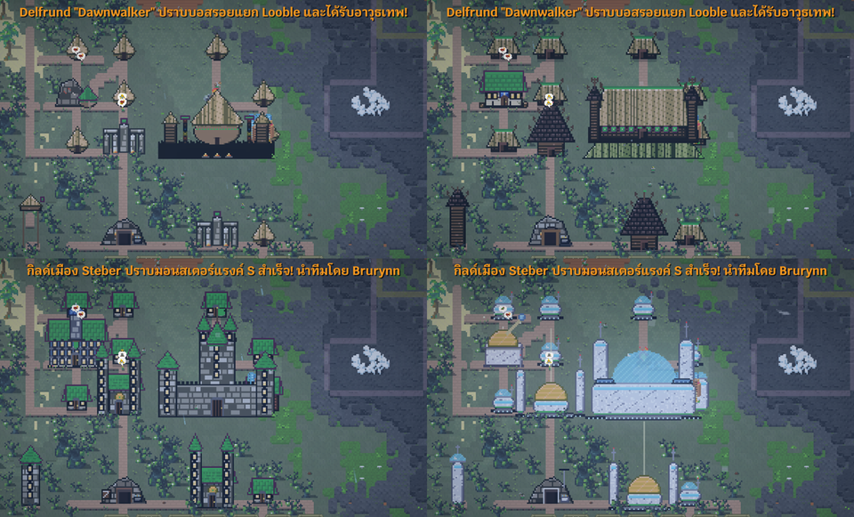
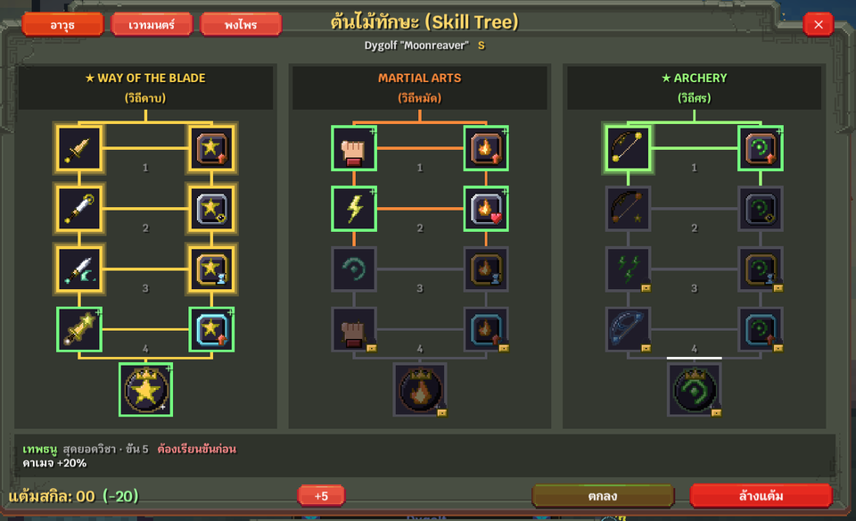
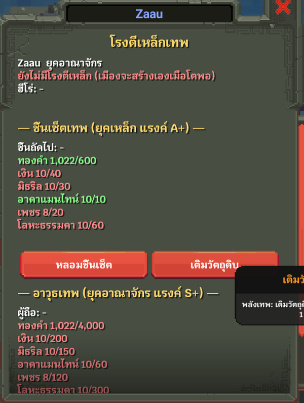
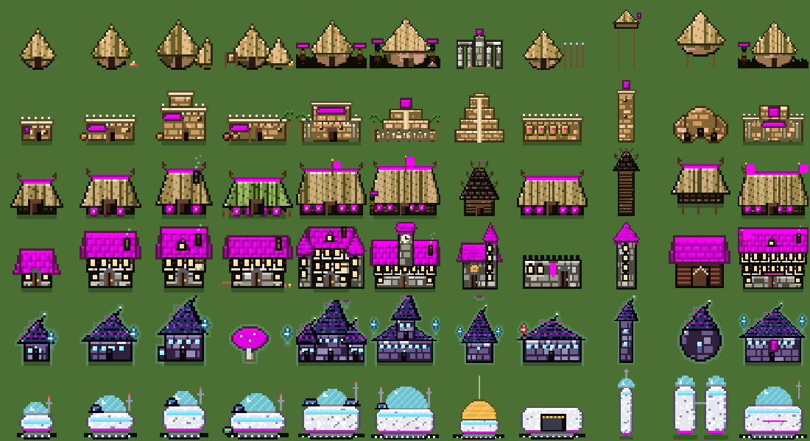
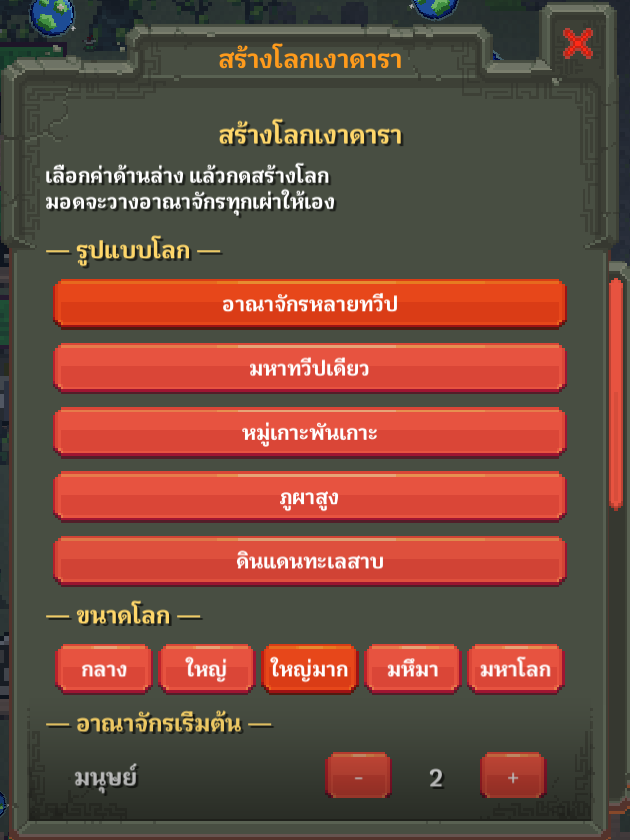
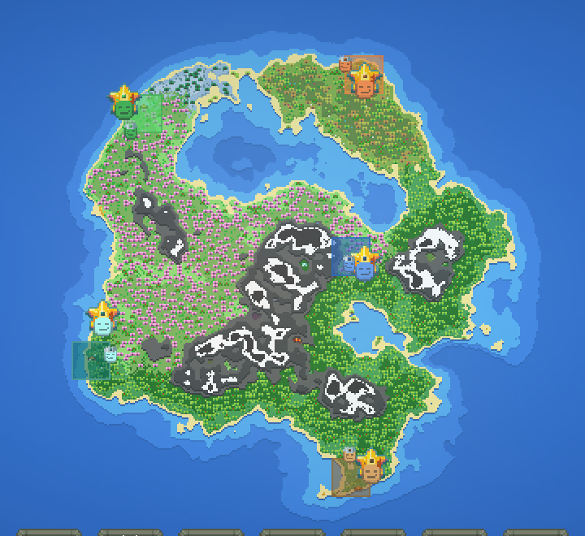

# Ngaodara: Age of Legends (เงาดารา: ยุคแห่งตำนาน)

A large modpack for **WorldBox** (built on [NeoModLoader](https://github.com/WorldBoxOpenMods/ModLoader)).
Heroes rise through ranks, cities grow through eras with their own architecture, and legends are written in the chronicle.
Fully playable in **Thai** and **English**.

## Features

**Heroes and power**
- Ranks E → D → C → B → A → S → SS → SSS → U → M → G, each with 12 stars. Breakthroughs can fail.
- Lifespan grows with rank. Reaching S takes about 100 years; S5★ and above need 500+ years.
- 7 RPG stats (STR, AGI, VIT, INT, SPI, LUK, CHA) up to 9,999,999,999, plus game level up to 10,000 (MAX). Level, rank and stats are linked.
- 30 classes, chosen at the guild when an NPC comes of age (or they stay freelancers).
- Skills:
  - class skills
  - divine set skills
  - divine weapon skills
  - a self-learned Skill Tree (9 branches, 81 nodes)
  - 7 slots, including an ultimate
- Own pixel-art skill effects for 11 elements, plus damage numbers.

**Gear**
- 20 divine sets × 6 pieces. Each set has a full-set effect and a set skill.
- 20 divine weapons. Each one is unique in the world and has its own weapon skill.
- City **Divine Forge**: cities gradually stockpile large amounts of resources to forge divine gear for their best hero.

**Cities and eras**
- 6 eras: Stone, Bronze, Iron, Kingdom, Magic, Star. Cities research their way forward.
- Every city building changes its **shape** with the city's era. Houses follow the game's upgrade levels, and the capital gets a king's castle.
- 15 new functional buildings built by cities of every race:
  - guild
  - tavern
  - bank
  - school
  - forge
  - healer
  - bakery
  - stable
  - courthouse
  - bathhouse
  - and more
- City economy: trade, taxes, banks, debt, crisis, guild fame.

**World and god tools**
- Ngaodara World Creator gives you a one-click new world:
  - 5 world shapes
  - size
  - kingdoms per race
  - starting era
  - starter heroes
- Character editor tabs inside the vanilla unit window:
  - stats
  - basic info
  - children
  - divine powers
  - skills
- City tabs:
  - storage
  - governance
  - forge
- Chronicle of legends, with clickable heroes and events.
- Rifts, calamities, cults, and all creatures and equipment unlocked.

| World Creator | New world |
|---|---|
|  |  |

## Install

1. Install [NeoModLoader](https://github.com/WorldBoxOpenMods/ModLoader) for WorldBox.
2. Copy the `NgaodaraPack` folder into `WorldBox/Mods/`.
3. Start the game. NML compiles the mod on launch.

## Repository layout

| Path | What |
|---|---|
| `NgaodaraPack/` | The mod itself: `Code/` (C#), `GameResources/` (pixel art), `Locales/` (th/en) |
| `art*.py`, `tools_*.py` | Python (Pillow) scripts that generate all the mod's pixel art |
| `balance_sim*.py` | Balance simulations for ranks, eras and lifespan |
| `DESIGN.md` | Design document (Thai) |
| `deploy.ps1` | Copies the mod into the game's Mods folder |

## Credits

Created by **Hoyturbro**. All art is original and generated by the scripts in this repo.
WorldBox © Maxim Karpenko. This is an unofficial fan mod.
